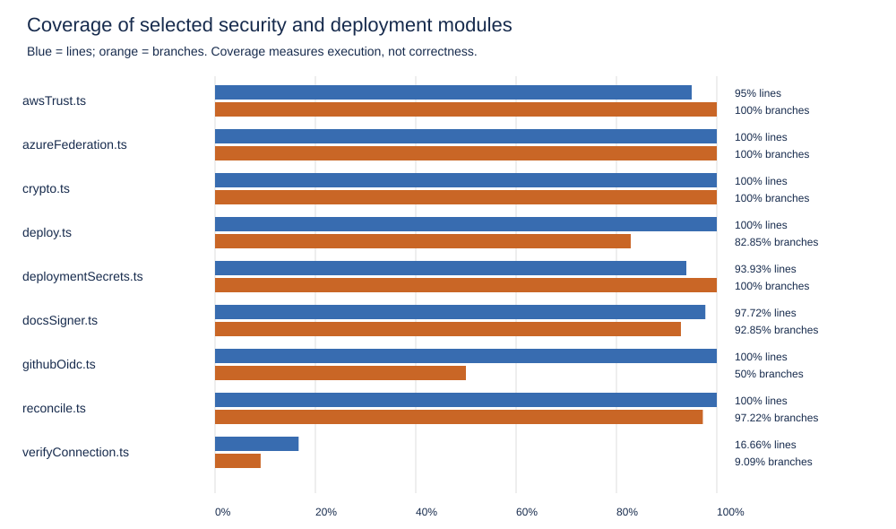

# Automated platform evaluation

> **Update, 18 October 2026.** This report is a snapshot of 11 October and its figures match the archived evidence beside it; they have not been edited. Since then the suite has grown to 909 tests, and coverage in the same scope to **98.06% of lines, 93.49% of branches and 96.51% of functions** (from 91.28%, 89.22% and 90.64%). Both gaps named below are closed: the tenant-secrets route and `verifyConnection.ts` are now at 100% line and branch coverage. Security evaluations added since then, with their own reports: [SEC-E2E-01 to 04](../security-e2e/REPORT.md), [mutation testing](../security-mutation/REPORT.md) and [concurrency under real PostgreSQL](../security-concurrency/REPORT.md); see `EVALUATION.md` §5.

Evaluation date: 11 October 2026 (Europe/Warsaw). Evidence timestamps are stored in UTC. Evaluated HEAD: 61de490076406567376e10fba567be5184c5421f, together with existing uncommitted workspace changes. Source hashes are recorded in summary.json. No new deployments, tenant documents, or cloud infrastructure were created.

## Method

The evaluation combines the existing Vitest test suite with V8 coverage, ESLint, TypeScript checking, npm dependency audits, local Terraform validation where available, historical post-OIDC deployments, and read-only health probes. Tests were executed once against the current workspace. They predominantly use mocked database/cloud services; workflow security tests read actual configuration files. This is an automated software and configuration evaluation, not a user study or a live cross-tenant penetration test.

## Functional and security checks

Across the full suite and a supplementary Git Bash run, **672 distinct tests passed**. No case was skipped in the full suite; the supplementary run re-executed the 7 shell-script tests, all passing. It is archived in bash-tests.json. Coverage percentages below come from the original full-suite run and do not incorporate this supplementary execution.

**672 tests passed, 0 were skipped, and 0 failed across 28 test files.** Skipped tests need a working Bash environment. They test Terraform-state initialization using CLI stand-ins. Any supplementary Bash run is archived separately rather than counted as a full-suite pass.

| Area | Passed | Skipped |
|---|---:|---:|
| Onboarding, documents and utilities | 275 | 0 |
| Security and configuration | 237 | 0 |
| Deployment and recovery | 160 | 0 |

Coverage in the configured scope: 91.28% lines, 89.22% branches, 90.64% functions. These percentages do not cover the whole application. They exclude most UI code, the database/auth modules and the separately deployed RAG backend.

| Module | Line coverage | Branch coverage |
|---|---:|---:|
| awsTrust.ts | 95% | 100% |
| azureFederation.ts | 100% | 100% |
| crypto.ts | 100% | 100% |
| deploy.ts | 100% | 82.85% |
| deploymentSecrets.ts | 93.93% | 100% |
| docsSigner.ts | 97.72% | 92.85% |
| githubOidc.ts | 100% | 50% |
| reconcile.ts | 100% | 97.22% |
| verifyConnection.ts | 16.66% | 9.09% |

Important gaps include the tenant-secrets HTTP route (0% line and branch coverage) and verifyConnection.ts (16.66% line coverage). Unit coverage of deploymentSecrets.ts does not constitute endpoint authentication testing; the security evaluation's live test S5 sends forged tokens to that endpoint over HTTP (../security/REPORT.md). githubOidc.ts has 100% line coverage but 50% branch coverage.

The deployPipeline suite contains 126 passing configuration assertions. It checks tenant-scoped federation, credential handling, Terraform state placement, and workflow constraints against repository files. Other tests exercise encryption, input rejection, ownership checks, document operations, callback validation and recovery using mocks. Passing these checks supports the tested implementation properties; it does not prove live cloud IAM or data isolation.

## Dependencies and code quality

| Audit scope | Critical | High | Moderate | Low | Total affected package entries |
|---|---:|---:|---:|---:|---:|
| All dependencies | 4 | 12 | 5 | 1 | 22 |
| Production dependencies only | 4 | 4 | 1 | 0 | 9 |

Counts represent npm audit affected package entries, including transitive propagation; they are not counts of independent exploitable defects. Advisories require applicability review against actual features and deployed versions. No dependency upgrades were performed as part of this measurement.

Production audit entries:

| Package | Severity | Direct dependency |
|---|---|---|
| @auth/core | critical | No |
| @auth/drizzle-adapter | critical | Yes |
| adm-zip | high | Yes |
| baseline-browser-mapping | moderate | No |
| next | critical | Yes |
| next-auth | critical | Yes |
| postcss | high | No |
| sharp | high | No |
| source-map-js | high | No |

TypeScript checking completed with no diagnostics (typecheck.txt). Source ESLint returned 11 errors and 1 warnings; details are archived in lint-source.json. Lint findings are code-quality checks rather than demonstrated security vulnerabilities.

Terraform aws: valid=true, errors=0, warnings=0. See terraform-aws.json.

Terraform azure: valid=true, errors=0, warnings=0. See terraform-azure.json.

Terraform validation checks configuration consistency; it is not a security scan. The security scanners, Checkov for the infrastructure and zizmor for the workflows, run in the security evaluation (scripts/evaluate-security.cjs), with results in ../security/REPORT.md.

## Deployment performance

See [post-OIDC evaluation](../oidc/REPORT.md) and its graphs. The database snapshot contains 29 deployment attempts, of which 10 match the customer OIDC period and verified workflows. AWS: 1 success / 4 attempts, successful duration 9.01 minutes. Azure: 2 successes / 6 attempts, successful durations 8.65 and 19.81 minutes (mean 14.23). All ten customer OIDC login steps succeeded; seven deployment failures happened subsequently. These are development-history observations, not independent controlled trials.

## Live reachability

1 active post-OIDC tenant was eligible for probing. 3 immediate GET /api/health requests to its recorded Azure cloud URL (2026-10-11T03:55:01.049Z) ended as: request_failed (ENOTFOUND). No HTTP response or application latency was measured. This does not establish the root cause: the recorded URL may be stale, infrastructure may have been removed independently, or DNS may be unavailable from the measurement environment. It does demonstrate that a historical successful deployment record alone is insufficient evidence of current service readiness. No AWS live comparison is available because no active post-OIDC AWS tenant was eligible.

## Thesis interpretation

The platform passes the executed functional and configuration checks, with strong coverage in several credential-handling modules. Historical records demonstrate successful customer OIDC authentication across both clouds and successful infrastructure deployment on each. However, low sample size, retries and changing configurations limit provider comparisons. Dependency advisories, untested endpoint paths, environment-dependent test execution and unavailable live health evidence prevent claims of complete security or sustained reliability.

A defensible Chapter 5 presents software/configuration validation separately from deployment-history evidence. Do not report user usability, manual effort reduction, answer quality, live tenant isolation, billing accuracy, or long-term availability as measured by this evaluation.

## Reproduction and artifacts

- Full suite: npm.cmd run test:coverage -- --coverage.reportsDirectory=docs/evaluation/automated/coverage --coverage.reporter=json-summary --coverage.reporter=json --coverage.reporter=html --reporter=json --outputFile=docs/evaluation/automated/tests.json
- Quality/environment checks: node scripts/run-evaluation-checks.cjs
- Dependency audit: npm.cmd audit --json and npm.cmd audit --omit=dev --json (archive outputs).
- Type check: node node_modules/typescript/bin/tsc --noEmit --incremental false
- Health: node scripts/evaluate-platform-health.cjs
- Report: node scripts/summarize-platform-evaluation.cjs

Raw reports and summaries are stored alongside this document. [Coverage HTML](coverage/index.html) lists covered and uncovered lines.
