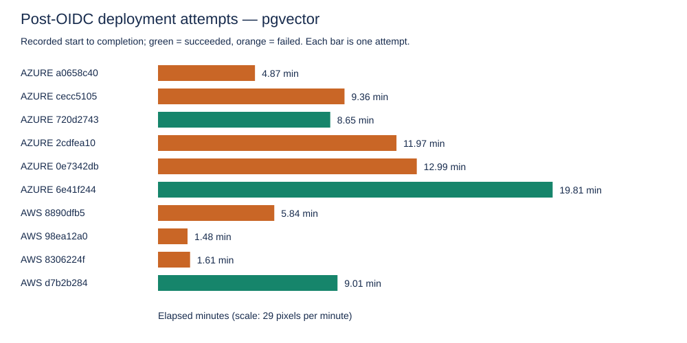
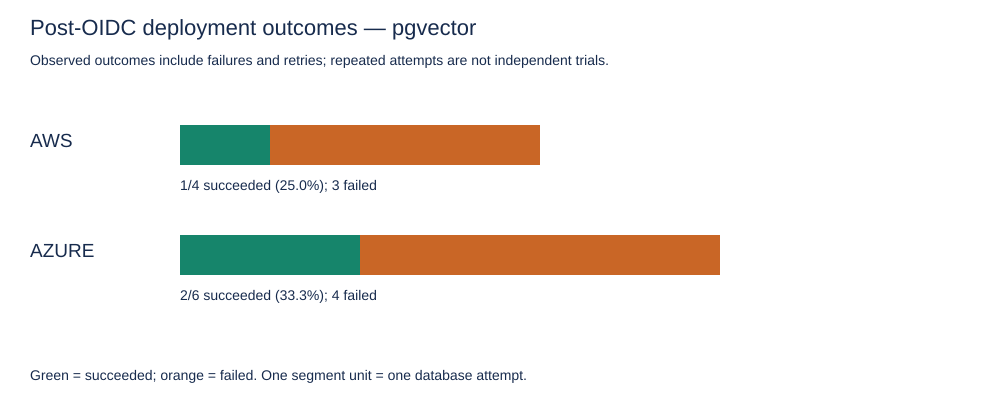
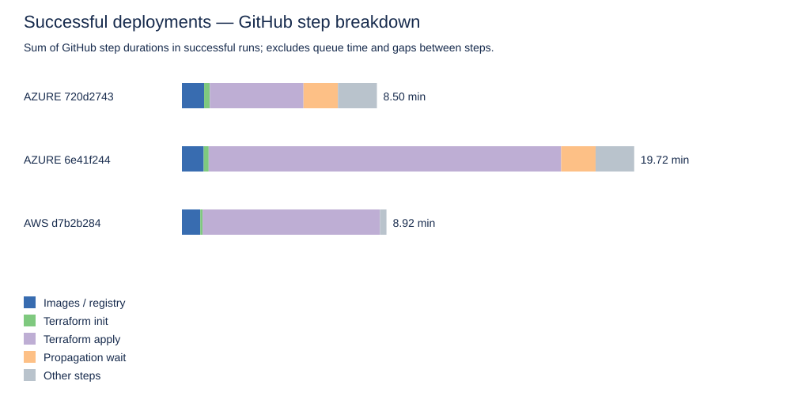

# Retrospective evaluation of automated OIDC deployments

Database extraction: 2026-10-09T22:08:48.737Z. No new deployments were created and no database records were modified.

## Selection and evidence

The database contains **41 deployment-history rows: 29 deployments and 12 teardowns**. Excluded 19 deployments before the customer OIDC implementation in commit c07316651018734ca06a0a46d890cf2a20c2945f, committed on 28 September 2026 at 03:02:44 Europe/Warsaw (2026-09-28T01:02:44Z). This is the direct customer-cloud federation change, distinct from earlier OIDC for platform credentials.

Of 10 post-cutoff candidates, 10 have workflow-source evidence of customer OIDC. AWS workflows explicitly assume the tenant role and clear existing credentials; Azure workflows use azure/login with client/tenant/subscription identifiers and no client secret. GitHub job records provide execution evidence and archived step timings. All candidate workflow runs have attempt number 1; platform retries are separate deployment records.

Cloud and vector store are joined from current tenant records. All retained rows are currently pgvector. Historical workflow versions are archived, but complete historical dispatch inputs and Terraform plans are not captured by this extraction, so immutable configuration equivalence is not proven.

## Outcomes

| Cloud | Attempts | Distinct tenants | Succeeded | Failed | Success rate | Successful mean (min) | Successful median (min) | Successful range (min) |
|---|---:|---:|---:|---:|---:|---:|---:|---|
| AWS | 4 | 1 | 1 | 3 | 25.0% | 9.01 | 9.01 | 9.01–9.01 |
| AZURE | 6 | 3 | 2 | 4 | 33.3% | 14.23 | 14.23 | 8.65–19.81 |

## Failure evidence

These are failed step names, not independently confirmed root causes. Definitive root causes require log inspection.

| Cloud | Deployment | Failed GitHub steps |
|---|---|---|
| AZURE | [a0658c40](https://github.com/kaltrinaT/ai-chatbot-platform/actions/runs/36637828399) | Retag and push images to tenant ACR |
| AZURE | [cecc5105](https://github.com/kaltrinaT/ai-chatbot-platform/actions/runs/36640227188) | Terraform apply — full deploy |
| AZURE | [2cdfea10](https://github.com/kaltrinaT/ai-chatbot-platform/actions/runs/37128904771) | Terraform apply — full deploy |
| AZURE | [0e7342db](https://github.com/kaltrinaT/ai-chatbot-platform/actions/runs/37131153968) | Terraform apply — full deploy |
| AWS | [8890dfb5](https://github.com/kaltrinaT/ai-chatbot-platform/actions/runs/37134553206) | Terraform apply |
| AWS | [98ea12a0](https://github.com/kaltrinaT/ai-chatbot-platform/actions/runs/37138293682) | Terraform apply |
| AWS | [8306224f](https://github.com/kaltrinaT/ai-chatbot-platform/actions/runs/37138434111) | Terraform apply |

## Interpretation and limits

Only three deployments succeeded: one AWS and two Azure runs. These records demonstrate that the implemented OIDC workflows could complete on both clouds. They do not establish predictable duration or production reliability. The observed failure proportions describe development history, including retries and configuration/code changes; they cannot be attributed solely to cloud-provider reliability.

Duration is database finished_at minus started_at, encompassing dispatch/queue/provisioning until the recorded terminal update. It is not time to a healthy chatbot or a correct answer. Database status agrees with GitHub conclusion for all retained rows if the evidence checks below pass. GitHub step totals are a different measure and exclude queue time and inter-step gaps.

The AWS successful duration is 9.01 minutes; the Azure successful mean is 14.23 minutes, with a 8.65–19.81 minute range. The sparse, unequal sample and changing workflow/Terraform versions prevent a defensible general claim that one cloud is faster. No significance test or p95 estimate is appropriate. The phase chart describes individual successful runs, including Azure's deliberate propagation wait.

Tenants may have been created before or after the change; inclusion is based on deployment implementation, not chatbot age. Fresh creation versus redeployment is not conclusively established from these fields. No Pinecone runs occur in the selected period, so there is no post-OIDC Pinecone comparison.

## Reproduction

Run node scripts/evaluate-oidc-deployments.cjs with existing environment credentials, then node scripts/plot-oidc-evaluation.cjs. history.json archives selected non-secret database fields, GitHub metadata, and job/step timings; workflow-*.yml archives workflow source at each run SHA. deployments.csv contains the selected attempts; summary.json contains chart inputs. The scripts read cloud-independent historical records and GitHub APIs only.

## Validation

All ten database outcomes agree with GitHub conclusions; all durations are nonnegative and all job archives are present. All ten customer OIDC login steps succeeded. Seven subsequent deployment failures occurred in Terraform apply (six) or image push (one). Therefore the recorded deployment failures are not failures of the OIDC login step.
